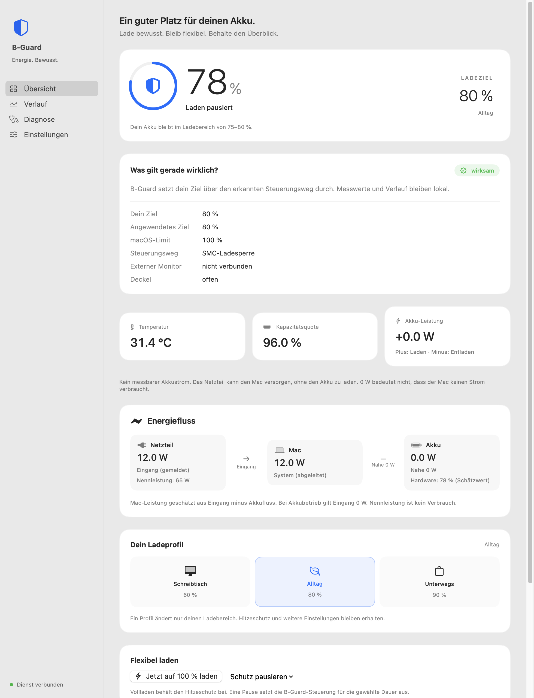

# B-Guard

Eine lokale macOS-App für bewusste Akkunutzung: Ladeprofile, geplante Ausnahmen und ein nachvollziehbarer Verlauf. Swift 6, macOS 14+, Apple Silicon.

[Website](https://darkspike1988.github.io/BatteryGuard/) · [DMG herunterladen](https://github.com/darkspike1988/BatteryGuard/releases/latest/download/B-Guard.dmg) · [GitHub](https://github.com/darkspike1988/BatteryGuard)

Geplante Verbesserungen und Abnahmekriterien stehen in der [Roadmap](ROADMAP.md).

## Abnahme, Journey und Ausbauplan

Die [Abnahmematrix und das lokale Testjournal](docs/validation/README.md) halten Geräte, Testschritte, Beobachtungen und Belege fest. Die [Entwicklungs-Journey](docs/JOURNEY.md) dokumentiert Änderungen und offene Prüfungen; der [Diagnostik-Ausbauplan](docs/DIAGNOSTICS_PLAN.md) beschreibt die nächsten Schritte zu belastbarer Akku- und Mac-Auswertung. Der [Releaseablauf](docs/release-validation.md) trennt Community-Build und praktische Notarisierung. Das Journal schaltet keine Hardwarefunktionen frei.

## Diagnose und Wirksamkeit ab 0.5.0

Version 0.5.0 beantwortet in der Übersicht, was gerade wirklich gilt: gespeichertes Ziel, vom Dienst angewendetes Ziel, macOS-Limit, Steuerungsweg sowie Monitor- und Deckelzustand. Die Diagnoseansicht zeigt Quellen und Datenqualität, Kapazitätsquote, lesende Mac-Ressourcen und bei aktivierter Aufzeichnung eine Akkugesundheit über bis zu zwölf Monate. [Umfang, Datenvertrag und offene Abnahmen](docs/diagnostics-0.4.md). App und Dienst stehen in Version 0.5.0; der Download oben verweist auf diese Version.

## Was B-Guard ergänzt

macOS bringt ein eigenes Ladelimit mit. B-Guard ergänzt Werkzeuge für den Alltag:

- **Ladeprofile:** Schreibtisch (45–50 %), Alltag (75–80 %) und Unterwegs (85–90 %). Das Schreibtischprofil liegt unter der Ladestufe von etwa 55–60 %, ab der die Lagerungsalterung sprunghaft zunimmt, und entspricht Apples Empfehlung von etwa 50 % für längere Lagerung. Eigene Grenzen bleiben in den Einstellungen verfügbar. Ohne separate Ladesperre hält macOS mindestens 80 %.
- **Reiseplanung:** Vollladen startet drei Stunden vor einem gewählten Termin. Ist der Akku vor dem Termin voll, bleibt er bis zum Termin voll. Danach gilt nach 100 %, spätestens eine Stunde nach dem Termin, wieder der vorherige Ladebereich. Der Mac muss wach und am Netzteil sein; eine vollständige Ladung zum Termin ist keine Garantie.
- **Zeitliche Schutzpause:** Eine, zwei oder zwölf Stunden mit automatischer Rückkehr zu den gespeicherten Einstellungen. Während der Pause greift B-Guard einschließlich Hitzeschutz nicht ein.
- **Einmaliges Vollladen:** Mit weiterhin aktivem konfiguriertem Hitzeschutz und einer maximalen Dauer von acht Stunden.
- **Lokaler Verlauf:** Ladung, Temperatur und Lade-/Entladeleistung. Ein Messpunkt pro Minute, bis zu sieben Tage. Aufzeichnung nur bei laufender App und aktuellen Messwerten; Schlaf- und Ausfallzeiten bleiben Lücken.
- **Auswertung:** Beobachtete Zeit, Zeit ab 90 % und Zeit ab 40 °C sowie höchste gemessene Temperatur. Keine erfundenen Verschleiß- oder Lebensdauerprognosen.
- **Wirksamkeit (ab 0.5.0):** Die Übersicht zeigt, welches Ziel gespeichert ist, welches der Dienst angewendet hat, welches macOS-Limit gilt und über welchen Weg gesteuert wird. Ein niedrigeres macOS-Limit wird als Begrenzung ausgewiesen; B-Guard ändert die Systemeinstellung nicht.
- **Akkugesundheit über 12 Monate (ab 0.5.0):** Optionaler lokaler Tagesverlauf für Kapazitätsquote, Zyklen und Höchsttemperatur über 30 Tage, 90 Tage oder ein Jahr. Fehlende Tage bleiben sichtbare Lücken; der CSV-Export enthält die Tageswerte.
- **Erinnerungen (ab 0.5.0):** Optionaler Wochenbericht und eine Kalibrierungserinnerung nach sechs Wochen ohne Vollladung. Die Erinnerung startet keine Kalibrierung.
- **Wartungshinweis (ab 0.5.0):** Meldet höchstens alle 30 Tage, wenn die geschätzte Akkukapazität unter eine einstellbare Grenze fällt (Standard 80 %). Der Hinweis ist keine Hardwarediagnose; der Wert ist zusätzlich über die lokale API auslesbar.
- **Energiefluss (ab 0.3.5):** Netzteileingang, Akku-Ladefluss und daraus geschätzte Mac-Leistung getrennt sehen. Netzteil-Nennleistung ist kein Verbrauch. Messwerte hängen von Hardware und macOS ab; fehlende Werte bleiben unbekannt. Rein lesend und ohne Dienstupdate.
- **Lokale REST API:** Status, gespeicherte Einstellungen und Verlauf als JSON oder CSV auslesen. Optionale Steuerbefehle für Profile, Pausen und Reiseplanung. Standardmäßig aus, nur lokal und mit Bearer-Token. [Dokumentation](docs/api.md).
- **CSV-Export:** Alle lokal vorhandenen Messwerte zum eigenen Auswerten.
- **Native Limit-Erkennung:** Liest das auf dem lokalen Mac bestätigte CHLT-Layout. Unbekannte Layouts bleiben unberücksichtigt. Erkennt mögliche Konflikte mit höheren B-Guard-Zielen und verweist auf die Systemeinstellungen.
- **Updates & Changelog:** Automatische GitHub-Prüfung höchstens täglich, abschaltbar. Neue Versionen mit Änderungen in Menüleiste und Hauptfenster; bei erlaubten Mitteilungen zusätzlicher Hinweis. DMG-Download mit Dateigrößen- und SHA-256-Prüfung, Versionshistorie auch offline. Downloads starten erst nach deinem Klick, zeigen den Fortschritt und lassen sich abbrechen.
- **Mitteilungen:** Niedriger Akkustand mit eigener Warnschwelle (5–50 %, Standard 20 %), erreichtes Limit und hohe Temperatur sind getrennt einstellbar. Freigabe über den Button in den Einstellungen.
- **Drei Sprachen:** Oberfläche auf Deutsch, Englisch oder Russisch. Die App folgt automatisch der macOS-Systemsprache.
- **Automatik (ab 0.5.0, optional):** Monitorprofil bei externem Bildschirm, Low Power Mode auf Akkubetrieb über die öffentliche macOS-Einstellung (`pmset -b lowpowermode`, wie „Nur bei Batteriebetrieb“ in den Systemeinstellungen; beim Abschalten wird der vorherige Wert wiederhergestellt) und ein Schlafassistent, der nur während einer vom Dienst ausgelösten Entladung höchstens 30 Minuten wachhält.

Eigene benannte Profile mit Import/Export und wiederkehrende Zeitpläne sind ab 0.3.7 umgesetzt. Die Regeln laufen im Hintergrunddienst; manuelle Ladeaktionen haben Vorrang. Top Up benötigt separate Ladesteuerung. Einmalentladung, Halten und Kalibrierung bleiben bis zur physischen Hardware-Abnahme gesperrt.

Experimentelle lesende und steuernde macOS-Kurzbefehle sind vorbereitet. Die systemweite Abnahme steht aus: [Anleitung und Grenzen](docs/shortcuts.md).

## Oberfläche

Die Menüleistenanzeige lässt sich auf Symbol, Prozent, Temperatur oder Akku-Leistung einstellen. Als Symbol stehen Ladering, Batterie und Schild zur Auswahl; die Darstellung lässt sich separat zurücksetzen. Temperatur, Akku-Leistung, Gesundheit und ab 0.3.5 eine Energiefluss-Karte (standardmäßig aus) sind im Menüfenster optional zuschaltbar und vom Zurücksetzen der Darstellung umfasst. Ab 0.3.6 lassen sich die Karten sortieren, kompakter darstellen und um die letzte Verlaufsmessung ergänzen. Das Menüleistenfenster bietet Status, Profile und schnelle Aktionen. Das Hauptfenster gliedert sich in Übersicht, Verlauf und Einstellungen. Systemtypografie, Systemfarben, Standard-Bedienelemente und Hell-/Dunkelmodus bilden die Grundlage.



Weitere Vorschauen: [Verlauf](docs/previews/light/history.png), [Menüleiste](docs/previews/light/menu.png), [Dunkelmodus](docs/previews/dark/overview.png).

## Zwei Steuerungsmodi

**macOS – nur beobachten:** macOS steuert das Laden. Profile, Reiseplan und Schutzpausen werden in diesem Modus nicht ausgeführt. Verlauf, Auswertung und Temperaturhinweise bleiben nutzbar.

**Automatisch:** Nutzt die SMC-Ladesperre, falls vorhanden. Fehlt sie (so auf dem Referenz-Mac unter macOS 27), hält das macOS-eigene Ladelimit (80–100 %, Systemeinstellungen → Batterie) den Akku; B-Guard zeigt dann an, auf welchen Wert du es stellen solltest, und warnt, wenn dein Ziel unter 80 % liegt.

Der frühere Pendelmodus wurde entfernt. Er trennte am Limit das Netzteil und ließ den Akku um fünf Prozentpunkte entladen. Das senkt die mittlere Ladung kaum, verursacht aber zusätzliche Teilzyklen; einen Nutzen für die Lebensdauer belegen Studien nicht (siehe [Belege](docs/EVIDENCE.md)). Gespeicherte Einstellungen mit Pendelmodus werden automatisch auf „Automatisch“ umgestellt; ein noch getrenntes Netzteil verbindet der Dienst wieder.

**Externer Monitor / geschlossener Deckel:** B-Guard hält das Netzteil verbunden, sobald ein externer Bildschirm erkannt wird oder der Deckel geschlossen ist. Aktives Entladen entfällt dann. Auf Macs ohne separate SMC-Ladesperre übernimmt macOS das Ladelimit, auch wenn ein B-Guard-Profil gewählt ist; der Status zeigt diese Einschränkung. Stelle das native Limit in den macOS-Batterieeinstellungen ein. Standardmäßig erzeugt B-Guard keine Schlafsperre; optional hält der Schlafassistent den Mac während einer aktiven Entladung bis zu 30 Minuten wach. Bei fehlgeschlagener Monitor-/Deckelerkennung bleibt das Netzteil vorsorglich verbunden.

Der frühere experimentelle Direktmodus ist nicht implementiert und wird nicht als verfügbare Option angeboten.

**Ein zusätzliches macOS-Limit kann höhere Ziele und Vollladen verhindern.** B-Guard verändert Apples native Einstellung nicht. Passe sie bei Bedarf in den macOS-Batterieeinstellungen an. Apples Akkumanagement kann weiterhin Einfluss auf den Ladevorgang haben.

## Installation ohne Terminal

1. [Aktuelle DMG herunterladen](https://github.com/darkspike1988/BatteryGuard/releases/latest).
2. DMG öffnen und **B-Guard auf „Programme“ ziehen**.
3. B-Guard aus Programme öffnen und **„B-Guard einrichten“** wählen. macOS fragt einmal nach einem Administratorpasswort für den Hintergrunddienst.

Die veröffentlichte SHA-256-Prüfsumme liegt im selben Release als [`B-Guard.dmg.sha256`](https://github.com/darkspike1988/BatteryGuard/releases/latest/download/B-Guard.dmg.sha256). Voraussetzungen: **Apple Silicon und macOS 14 oder neuer**. Die Menüleiste bietet Ladeprofil-Auswahl, eigene Ladegrenzen, Schutz ein-/ausschalten, zeitlich pausieren und Beenden. Eine Profilwahl aktiviert B-Guard im Auto-Modus, falls zuvor nur macOS beobachtet wurde, und beendet laufendes Vollladen. Zukünftige Reisepläne bleiben erhalten. „Beenden“ schließt die App; der Dienst läuft weiter. „Schutz ausschalten“ gibt das Laden bis zur erneuten Aktivierung frei. Zeitliche Pausen enden automatisch.

Diese Community-Version ist ad-hoc signiert und **nicht notarisiert**. macOS kann den ersten Start blockieren. Falls du der heruntergeladenen App vertraust, lässt sie sich nach einem Öffnungsversuch unter **Systemeinstellungen → Datenschutz & Sicherheit → Dennoch öffnen** freigeben. [Anleitung von Apple](https://support.apple.com/102445). Für eine Installation ohne diese zusätzliche Freigabe werden Developer-ID-Signierung und Notarisierung benötigt.

**Update auf 0.5.0:** App 0.5.0 und Hintergrunddienst 0.5.0 verwenden. Ein älterer Dienst muss aktualisiert werden. Nach dem Ersetzen der App den Dienst in den Einstellungen über den macOS-Administratordialog aktualisieren. Bestehende Konfiguration und Verlauf bleiben erhalten. Das WidgetKit-Widget ist nicht enthalten; die App bleibt ad-hoc signiert und nicht notarisiert.

**Update auf 0.4.2:** App 0.4.2 und Hintergrunddienst 0.4.0 verwenden. Die App übernimmt Deutsch, Englisch oder Russisch automatisch aus der macOS-Systemsprache. Ein älterer Hintergrunddienst muss aktualisiert werden. Nach dem Ersetzen der App den Dienst in den Einstellungen über den macOS-Administratordialog aktualisieren. Bestehende Konfiguration und Verlauf bleiben erhalten.

**Update auf 0.4.1:** App 0.4.1 und Hintergrunddienst 0.4.0 verwenden. Ein älterer Hintergrunddienst muss aktualisiert werden. Nach dem Ersetzen der App den Dienst in den Einstellungen über den macOS-Administratordialog aktualisieren. Bestehende Konfiguration und Verlauf bleiben erhalten.

**Update auf 0.3.3:** Ein vorhandener Hintergrunddienst 0.3.2 kann weiterlaufen. Die neuen Menü- und Warnoptionen benötigen keine Administratorfreigabe.

**Umstieg auf 0.3.2:** Nach dem Ersetzen der App den Hintergrunddienst in den Einstellungen aktualisieren. Version 0.3.2 benötigt Dienst 0.3.2 für atomare Ladebefehle. Bis zur Aktualisierung werden Steueraktionen nicht freigegeben; der alte Dienst führt seine gespeicherten Einstellungen weiter aus. Das Update bewahrt Konfiguration und Verlauf.

**Updates:** App beenden, neue App nach Programme ziehen und ersetzen, wieder öffnen. Den Hintergrunddienst bei einem angezeigten Versionshinweis in den Einstellungen aktualisieren. Konfiguration und Verlauf bleiben erhalten. Updates & Neuigkeiten erreichst du direkt aus der Menüleiste oder den Einstellungen.

## Aus Quellcode bauen

```sh
swift test
./scripts/build-dmg.sh
```

Der geprüfte Bundle-Build mit App-Intents-Metadaten benötigt vollständiges Xcode 27. Die fertige App benötigt beim Nutzer kein Xcode. Erstellt App, ZIP, DMG und SHA-256-Prüfsumme unter `dist/`. Die DMG enthält die App, einen Programme-Link und eine kurze Anleitung. Alternativ installiert `./scripts/install-app.sh` die lokal gebaute App; der Dienst lässt sich aus den Einstellungen einrichten.

```sh
# Nur lesende Diagnose; keine Systemdateien oder SMC-Werte ändern
.build/debug/batteryguardd --once

# Einmaliger Energiefluss-Snapshot als JSON (ohne Einstellungs- oder Steuerungsänderungen)
B-Guard.app/Contents/MacOS/BatteryGuard --read-power-flow

# Gerenderte Entwickler-Vorschauen, isoliert von Benutzer-Konfiguration und Verlauf
.build/debug/BatteryGuard --render-preview /tmp/B-GuardPreview
.build/debug/BatteryGuard --render-preview /tmp/B-GuardDark --dark
```

Weitere Renderingzustände: `--desktop`, `--native`, `--offline`, `--travel`, `--warm`, `--empty-history`, `--small`.

## Daten und Betrieb

- Konfiguration und Dienststatus: `/Library/Application Support/BatteryGuard/` (root-eigen, 0644). Änderungen übernimmt der lokale Einstellungsdienst nach Benutzerprüfung.
- Benutzerverlauf: `~/Library/Application Support/BatteryGuard/history.jsonl` (JSON Lines, ein Messpunkt pro Zeile; 0600, Verzeichnis 0700). Ein vorhandenes `history.json` früherer Versionen wird einmalig übernommen.
- Keine Cloud für Akkuwerte, kein Konto, keine Telemetrie. Automatische Updateprüfungen kontaktieren GitHub höchstens täglich; abschaltbar. Manuelle Prüfungen und Downloads kontaktieren ebenfalls GitHub.
- Der Root-Dienst bleibt beim Beenden der App aktiv, einschließlich Zeitplänen. Die Verlaufsaufzeichnung endet.
- Autostart und Dock-Sichtbarkeit lassen sich in den Einstellungen ändern.
- SMC-Steuerung verwendet undokumentierte Hardware-Schlüssel. Unbekannte oder abgelehnte Schreibvorgänge werden als Fehler angezeigt.

Der Dienst ersetzt die Konfiguration atomar (temporäre Datei, `F_FULLFSYNC`, `rename`) unter einer eigenen Schreibsperre; App und Dienst lesen deshalb immer einen vollständigen Stand, auch nach Absturz, Stromausfall oder vollem Datenträger. Änderungen laufen über einen lokalen Unix-Socket: Der Dienst prüft die tatsächliche Prozess-UID und akzeptiert nur root oder den aktuellen macOS-Konsolenbenutzer. Die App prüft ihrerseits, dass der Dienst root ist. Lokale Änderungen werden feldweise mit aktuellen Dienständerungen zusammengeführt; andere lokale Benutzer erhalten keine Schreibfreigabe. Beim schnellen Benutzerwechsel kann die zuvor aktive Sitzung keine Änderungen mehr speichern.

Der Dienst sichert gültige Einstellungen vor Änderungen. Bei beschädigtem JSON bleiben die Originalbytes in einer Sicherungsdatei erhalten; ein gültiger vorheriger Stand oder Standardwerte werden mit ausgeschaltetem Schutz wiederhergestellt. Prüfe die Einstellungen vor erneuter Aktivierung. Beschädigte Verlaufsdateien werden ebenfalls gesichert, anschließend beginnt die Aufzeichnung neu.

Vor dem Systemschlaf verbindet der Dienst immer das Netzteil; aktives Entladen endet. Liegt der Akku im Automatikmodus mit SMC-Ladesperre bereits im Zielbereich, bleibt die Ladesperre im Schlaf gesetzt, damit der Mac über Nacht nicht bis 100 % lädt. Unter der unteren Grenze, bei Pause, Vollladen, Reiseplan, Sonderaktionen und ohne Ladesperre übernimmt macOS das Laden wie bisher. Nach dem Aufwachen wird neu geprüft. Monitoränderungen lösen eine sofortige erneute Prüfung aus. Bekannte Hardware-Schalter werden ungefähr jede Minute nachgelesen; nicht verifizierbare Zustände werden nicht als Erfolg gewertet. Hardware-Schreibtests sind nicht durch reine Logiktests ersetzt.

## Lokale Automatisierung

Die optionale [REST API v1](docs/api.md) ist standardmäßig aus und nur unter `127.0.0.1:8767` erreichbar. Bearer-Token und eine separate Freigabe für Schreibaktionen schützen die Schnittstelle. Ab Version 0.3.5 stellt `GET /api/v1/power-flow` einen authentifizierten Snapshot des Energieflusses bereit (`available`, `sampledAt`, `source` und optionale Leistungswerte; bei veralteten Daten ohne numerische Werte). Die App muss laufen.

## Entfernen

```sh
./scripts/uninstall-app.sh
sudo ./scripts/uninstall-daemon.sh
```

`--purge` am Daemon-Uninstaller löscht zusätzlich die Systemkonfiguration und Dienstlogs, aber nicht den Benutzerverlauf. Ohne Dienst übernimmt macOS wieder die Ladesteuerung.

## Lizenz und technische Referenzen

MIT. Die folgenden öffentlichen Projekte dokumentieren praktische Einheiten und beobachtetes Hardwareverhalten, keinen offiziellen Apple-Vertrag: [actuallymentor/battery](https://github.com/actuallymentor/battery), [charlie0129/batt](https://github.com/charlie0129/batt), [mhaeuser/Battery-Toolkit](https://github.com/mhaeuser/Battery-Toolkit), [robzr Gist](https://gist.github.com/robzr/2abf9c7e7f576d8af00d90b671489b48) und [isliliming/power-flow-lite](https://github.com/isliliming/power-flow-lite). Der Anwendungscode ist eine eigenständige Swift-Implementierung.

Designreferenz: [Apple Human Interface Guidelines für macOS](https://developer.apple.com/design/human-interface-guidelines/designing-for-macos/). Native macOS-Funktionen: [Apple Support zum Ladelimit](https://support.apple.com/en-au/102338).

## Signierte Veröffentlichung vorbereiten

`scripts/build-notarized.sh` unterstützt Developer-ID-Signierung mit Hardened Runtime, Notarisierung und angehefteten Tickets für App und DMG. Dafür müssen `BGUARD_SIGN_IDENTITY` und `BGUARD_NOTARY_PROFILE` auf eine vorhandene Developer-ID-Application-Identität und ein zuvor eingerichtetes notarytool-Keychain-Profil verweisen. Zugangsdaten bleiben im Schlüsselbund. Ohne diese Voraussetzungen bleibt `build-dmg.sh` bei der ad-hoc signierten Community-Version.

Der Dienst-Installer kopiert die Binary zuerst in ein root-eigenes Verzeichnis, prüft dort die Code-Signatur und ersetzt die installierte Datei atomar. Er bricht ab, wenn `/usr/local` oder `/usr/local/libexec` nicht ausschließlich root gehören. Mit `BGUARD_TEAM_ID` gebaute Developer-ID-Versionen akzeptieren nur Dienste mit dieser Team-ID. Im ad-hoc signierten Community-Build bleibt eine Grenze: Ein Prozess des angemeldeten Benutzers kann das App-Bundle in Programme austauschen. Die vollständige Lösung ist Developer-ID-Signierung mit Notarisierung und `SMAppService.daemon`, bei der launchd die Signatur selbst prüft. Heruntergeladene Updates erhalten wie Browser-Downloads das Quarantäne-Attribut, damit Gatekeeper die neue App beim ersten Start prüft.

Der notarisierten Pfad ist vorbereitet, aber mangels Developer-ID-Zertifikat auf diesem Mac noch nicht durchgehend geprüft. [Apple zur Notarisierung](https://developer.apple.com/documentation/security/customizing-the-notarization-workflow).

[Plan zur Arbeit mit den verbleibenden Modellkontingenten](docs/CONTINGENT_PLAN.md): Aufgabenverteilung, geprüfter Umfang und gemeldete CLI-Nutzungswerte.
